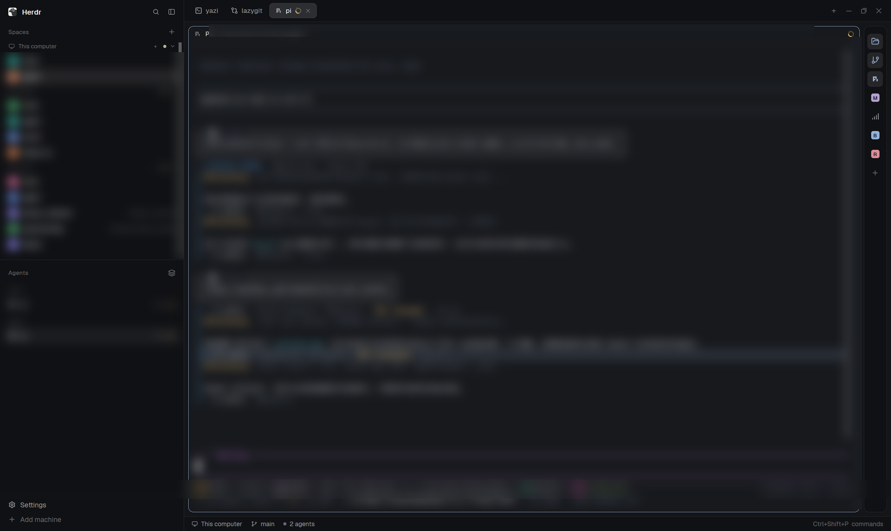

English | [简体中文](README.zh-CN.md)

# RailButton

Rail button turns any terminal command into a button in your Herdr window: yazi, lazygit, btop, k9s, a one-line file server, your own scripts — if a terminal can run it, the rail can hold it. One click opens the command in a new tab of the current space, or in a pane to the right — your choice per button; a second click closes it. Add buttons through a small form, drag to reorder, right-click one for its settings. Icons match themselves from the command name — you never pick one.



## Install

The mod is `place: none`: it draws only where a layout puts it, and no copy runs until a block references it. Installing is therefore two steps — copy `mods/rail-button/` into `~/.config/herdr-app/mods/`, and put the 44px column into a layout, at the right end of the row that holds the tab block. There is no key to bind and no popup to close.

Herdr's own layouts (`main`, `terminals`, `win98`) are replaced on every start, so the column belongs in a personal layout: write the shown tree plus the column under a new name (`main-rail`) and switch to it. Herdr reloads layout files at once and leaves the click state in `layouts/.state/` alone, unlike `layout.set`, which drops it. The node shape is in [Requirements](#requirements); the exact tree is in [RECIPE.md](RECIPE.md).
Or hand it to the agent in your Herdr window, which installs the mod and puts the rail into the layout you use:

> Read `~/.config/herdr-app/AGENTS.md`, then add this mod: https://github.com/lemonkiller/rail-button — and add a 44px column with a rail-button block to my current layout, as the last child of the row that holds the tab block (the shape is in the mod README's Requirements).

## What it does

- A column of 30px icon buttons in a 44px sidebar, plus a `+` button at the bottom. Tooltips replace labels.
- Click a button: the command opens in a new tab of the current space (named after the button), or in a pane split off the right of the focused pane — the button's `Open in` setting picks which. Click again: that tab or pane closes. Each button keeps at most one instance per space — spaces stay independent.
- Tabs are found again across machines: the terminal gets a `rail=<id>` label (applied through `hc exec --on` on the remote), so a button re-attaches to its tab even after a restart or on another machine of your setup.
- Restore on start: tick **Restore on start** in a button's settings and Herdr, when it starts, types the command back into the tab or pane that button owns if that terminal is sitting at a shell again (a reboot, a logout, a core restart). The tab, pane, address, folder and label are kept, so nothing is opened, renamed or closed; a tab or pane you closed yourself is not resurrected. The rail runs only while its block is in the layout Herdr shows, so the sweep happens the first time the rail appears after a start: keep the rail in that layout for it to fire on its own.
- Drag to reorder (movement past 4px counts as a drag; an accent line marks the drop edge). Right-click a button for its settings: command, name, `Open in` (new tab or right pane), `Restore on start` and a Delete button. Changing the command or the open mode closes the instance the button still claims, so no orphan tab or pane is left behind.
- The `+` button opens an add form: type a command, optionally a name, pick `Open in`, tick `Restore on start` if you want it back after a restart, done. Duplicate commands are rejected; the button's stable id is derived from the command's first word.
- Icons resolve in three steps: `icons/<first word>.svg` shipped in this mod, then Herdr's own icon library, then a colored first-letter tile — the same command always gets the same color.
- Ships with two buttons seeded: **yazi** (terminal file manager) and **lazygit** (git TUI).
- Failure path: if a command exits immediately (not installed, or a shell built-in like `dir`), the button shows a failure state with a notification after 1.5 seconds and cools down for 2 seconds — no dead tab or pane is left behind.
- Name guard: tabs whose name degrades to a bare number (a cross-machine snapshot clobber) are renamed back to the program name within 5 seconds. Tabs you named yourself are never touched.

## Requirements

- The Herdr desktop app.
- A layout with a block that references the mod, inside a narrow column, placed as the last child of the row that holds the tab block so the rail sits at the window's right edge. Without it the mod loads but has nowhere to draw. The shape used in development:

```json
{
  "id": "tools",
  "type": "column",
  "children": [
    { "id": "rail", "type": "block", "content": { "mod": "rail-button" } }
  ],
  "size": { "px": 44 },
  "min": 44,
  "max": 44,
  "padding": [8, 0],
  "background": "chrome",
  "border": { "width": 1, "color": "border" },
  "radius": 10,
  "resizable": false
}
```

- Buttons run local commands through terminals, and the mod calls `hc` to label terminals across machines of your setup. It reads and writes only inside its own mod folder (plus Herdr's icon directory).

## Bindings cookbook

Out of the box you get `yazi` and `lazygit`. Add anything else with the `+` button — the command is the only required field.

| Command | Use it for |
|---|---|
| `yazi` | Terminal file manager (preinstalled) |
| `lazygit` | Git TUI (preinstalled) |
| `btop` or `htop` | System monitor; `bottom` works too if you prefer its UI |
| `lazydocker` | Docker containers at a glance |
| `k9s` | Kubernetes clusters |
| `mycli` / `pgcli` | MySQL / Postgres with autocomplete |
| `python -m http.server 8000` | One-liner local file server |
| `./scripts/dev.sh` | A project script you keep reaching for |

Any executable, any one-line command, any script with a shebang works. A few things to know:

- The icon is matched from the command's first word. If nothing matches, you get a colored first-letter tile — readable, never broken.
- A command that is not installed, or a shell built-in (`dir`, `cd`), cannot hold a tab: the button enters a failure state with a notification instead, and nothing opens.

## Files

- `mods/rail-button/main.js` — the rail: buttons, tabs, drag-reorder, dialogs, guards.
- `mods/rail-button/mod.json` — `place: none`.
- `mods/rail-button/icons/yazi.svg`, `icons/lazygit.svg` — icons for the seeded buttons; `icons/tick.svg` — the restore checkbox's tick.
- `RECIPE.md` — the full build brief in the official six-section format.
- `preview.png` — the listing screenshot.

## License

MIT. See [LICENSE](LICENSE).
