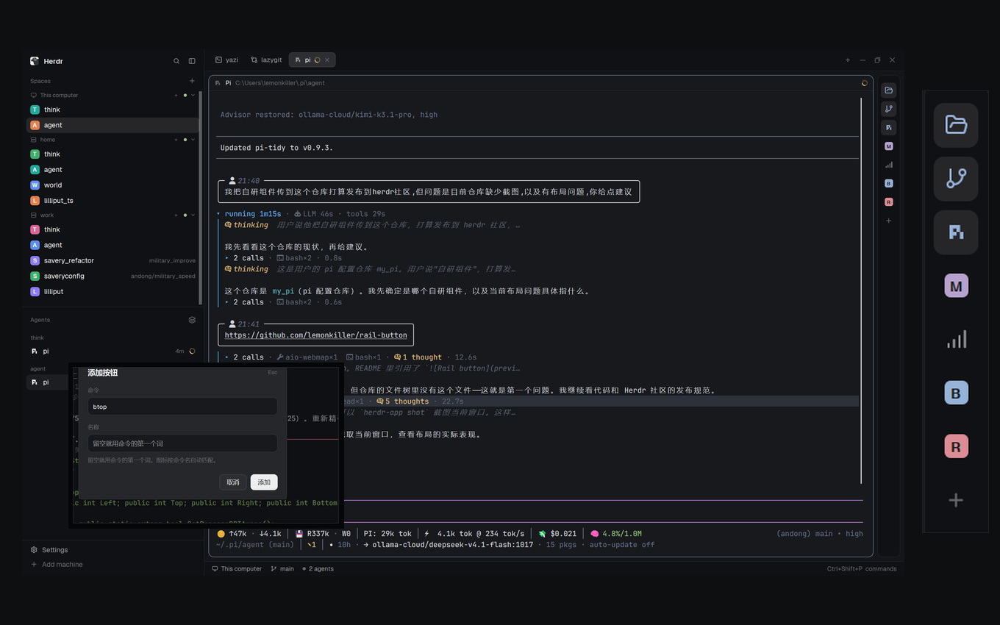

English | 简体中文

# Rail button（侧栏按钮条）

一条 44px 宽的 Herdr 侧栏图标条：一列按钮，每个绑定一条终端命令。点一下按钮，命令在当前空间的新 tab 里打开；再点一下，tab 关闭。通过一个小表单添加自己的按钮，拖动排序，右键删除。图标按命令名自动匹配——你永远不用挑图标。

终端能跑的，rail 都能装——文件管理器、git TUI、系统监控、数据库客户端、一行命令起的服务：整个终端生态，变成 Herdr 窗口里的一个图标。



## 安装

对 Herdr 窗口里的 agent 说一句话，装 mod 和布点一次完成：

> Read `~/.config/herdr-app/AGENTS.md`, then add this mod: https://github.com/lemonkiller/rail-button — and add a 44px column with a rail-button block to my current layout (the shape is in the mod README's Requirements).

这个 mod 是 `place: none`，只画在布局给它安排的位置——你的布局需要一根窄列，内含一个引用该 mod 的 block。形状见[安装要求](#安装要求)，精确 node 树见 [RECIPE.md](RECIPE.md)。

## 功能一览

- 44px 侧栏里一列 30px 图标按钮，底部一个 `+` 按钮。说明全靠 tooltip，不占空间。
- 点按钮：命令在当前空间开一个新 tab，tab 名就是按钮名。再点：关闭该 tab。每个按钮在单个空间最多持有一个 tab——各空间互不干扰。
- 跨机找回 tab：终端会被打上 `rail=<id>` 标签（远程机器经 `hc exec --on` 下发），所以重启之后、或者换你配置里的另一台机器，按钮都能重新认领自己的 tab。
- 拖动排序（位移超过 4px 才算拖动；落点边缘画一条强调线）。右键按钮弹出删除确认对话框。
- `+` 按钮打开添加表单：填一条命令，名字可选，完事。重复的命令会被拒绝；按钮的稳定 id 由命令第一个单词派生。
- 图标按三级顺序解析：本 mod 自带的 `icons/<命令首词>.svg` → Herdr 内置图标库 → 首字母色块（同一个命令永远同一种颜色）。
- 预置两个按钮：**yazi**（终端文件管理器）和 **lazygit**（git TUI）。
- 失败处理：命令立即退出（没安装，或是 `dir` 这类 shell 内建命令）时，1.5 秒后按钮进入失败状态并弹通知，冷却 2 秒——不会留下一个死 tab。
- 名字守护：tab 名退化成纯数字（跨机快照冲掉的场合）时，5 秒内自动改回程序名。你自己手动命名的 tab 永远不碰。

## 安装要求

- Herdr 桌面应用。
- 布局里要有一根窄列，内含引用该 mod 的 block。没有它 mod 能加载但没有地方画。开发时用的形状：

```json
{
  "id": "tools",
  "type": "column",
  "children": [
    { "id": "rail", "type": "block", "content": { "mod": "rail-button" } }
  ],
  "size": { "px": 44 },
  "min": 44,
  "max": 44,
  "padding": [8, 0],
  "background": "chrome",
  "border": { "width": 1, "color": "border" },
  "radius": 10,
  "resizable": false
}
```

- 按钮通过终端运行本地命令；mod 还会调用 `hc` 给你配置里各机器的终端打标签。它只在自己 mod 文件夹内读写（外加 Herdr 的图标目录）。

## 绑定手册

开箱自带 `yazi` 和 `lazygit`。其余的用 `+` 按钮随便加——命令是唯一必填项。

| 命令 | 适合场景 |
|---|---|
| `yazi` | 终端文件管理器（预置） |
| `lazygit` | git TUI（预置） |
| `btop` 或 `htop` | 系统监控；喜欢别的 UI 也可以换 `bottom` |
| `lazydocker` | 一眼看清 Docker 容器 |
| `k9s` | Kubernetes 集群 |
| `mycli` / `pgcli` | 带自动补全的 MySQL / Postgres 客户端 |
| `python -m http.server 8000` | 一行命令起本地文件服务 |
| `./scripts/dev.sh` | 你天天要跑的项目脚本 |

任意可执行文件、任意一行命令、任意带 shebang 的脚本都行。几点须知：

- 图标按命令第一个单词匹配。匹配不到就给一个彩色首字母块——可读，永不破图。
- 没安装的命令、或 shell 内建命令（`dir`、`cd`）占不了 tab：按钮进入失败状态并弹通知，什么都不会打开。

## 文件

- `mods/rail-button/main.js` — 本体：按钮、tab 管理、拖动排序、对话框、守护。
- `mods/rail-button/mod.json` — `place: none`。
- `mods/rail-button/icons/yazi.svg`、`icons/lazygit.svg` — 预置按钮的图标。
- `RECIPE.md` — 官方六段格式的完整构建说明书。
- `preview.png` — 收录页截图。

## 许可

MIT，见 [LICENSE](LICENSE)。
