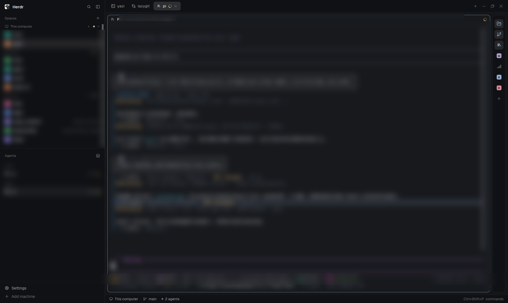

# RailButton

A 44px sidebar rail with one column of icon buttons, each bound to a terminal command. Click a button and its command opens in a new tab of the current space, or in a pane split off the right of the focused pane; click it again and that tab or pane closes. A `+` button at the bottom adds a binding through a small form, holding a button and moving it reorders the rail, right-clicking one opens its settings (command, name, open mode, delete). Two buttons ship seeded — yazi and lazygit — and icons are matched on their own from the command name.

**What you see**

A single vertical column, 44px wide, padding 8px top and bottom, 1px border, 10px radius, on the chrome background. Inside it, centered, buttons of 30×30px with 7px radius and 6px gaps, starting 6px from the top. Each button holds a 16px icon; a button with no matching icon file holds a 16px square with a 4px radius, filled with one of six ANSI theme colors and carrying the command's first letter in 9.5px semibold, in the background color.

A button's color says what it is doing. Closed: muted icon on no background. Open: the icon takes the accent color on the `selected` background. Opening: dim icon — the state between the click and the tab appearing. Failed: the icon takes the `blocked` color for 2 seconds after a command that exits immediately. Hover lifts any button to the `hover` background with foreground-colored icon. Below the last button sits the same 30×30 tile holding a 14px plus icon, dim until hovered.

While a button is being dragged it goes to 40% opacity, and the button under the pointer gets a 2px accent line — full width minus 4px on each side, 1px radius — drawn on the far side of the row: at `bottom(-4)` when the dragged button started above the target, at `top(-4)` when it started below. Nothing else on screen moves.

The `+` dialog is 420px wide, padded 18px, on the popover background. Title "Add button" in 15px semibold, with a dim 11px "Esc" on the right. Two fields, 36px high, 10px horizontal padding, 9px radius, 1px input-colored border on the background color, 12.8px text: "Command" with the placeholder `Command, for example lazygit or npm run dev`, and "Name" with `Leave empty to use the command's first word`. Under them, dim 11.5px: "Leave empty to use the command's first word. The icon is matched automatically from the command name." Then an "Open in" row: two option buttons in the same 32px style, "New tab" and "Right pane", the chosen one on `solid` and the other on `raised`. Two buttons at the bottom right, 32px high, 14px horizontal padding, 8px radius, 12.5px medium: "Cancel" on `raised` with an `input` border, "Add" on `solid` with `solid_foreground` text.

The settings dialog (right-click; 380px wide, same padding and type scale) is the add form's twin: title "Button settings" in 15px semibold with the dim "Esc" on the right, the same "Command" and "Name" fields (prefilled), the same "Open in" row, and a bottom row with "Delete" on the left in the `blocked` text color, then "Cancel" and "Save" on the right in the Cancel/Add style.

Notifications are Herdr's own: "A button for this command already exists" (warning, 4 seconds), "Command did not start" (error, 5 seconds, with the body "<cmd> exited immediately: it may not be installed, or it may be a shell built-in (such as dir)"), and "Close failed" (error, 5 seconds, "The tab for <name> cannot be closed, please close it manually").

Tooltips carry the state: `<name>: click to open, hold and drag to reorder, right-click to delete`, or `click to close`, or `opening...`, or `the command did not start, try again later or right-click to delete`.

**How it behaves**

A left press records the pointer position and marks that button as pressed. Moving more than 4px (measured as squared distance against 4×4, so shaky hands never reorder anything) turns the press into a drag; the button under the pointer becomes the drop target. Release with a different target reorders; release on the same button without crossing the threshold toggles that button's tab. Release in the gap below the buttons still lands the drag, because the rail container handles the release too. Pressing outside the rail clears any leftover drag state. The rail scrolls vertically if the buttons outgrow the window.

Clicking a closed button opens a tab in the current space, in the focused pane's working directory (falling back to the space folder), named after the button, running the command's argv. The slot is claimed before the tab exists, so a second click while it opens is swallowed instead of opening a duplicate. A 350ms same-frame lock guards two clicks in one frame, because `shared` writes travel through Herdr's process and are not visible in the same frame.

Clicking an open button closes its tab with confirmation, then re-checks at 600ms, 1200ms and 1800ms, retrying the close each time until the tab is gone, because a close across machines can fail silently. Only when the tab is confirmed gone is the per-space record dropped; if it survives all three retries, the record is dropped anyway and "Close failed" asks you to close it by hand.

A command that exits immediately leaves no tab behind: 1.5 seconds after opening, if the tab is gone, the button records a failure, notifies "Command did not start", and holds the failed look for 2 seconds. Clicks in that window are swallowed, so repeated clicking shows one notification rather than a stack of them.

A pane-mode button uses `terminal.open { argv, folder, place: "right" }` instead: it splits a pane off the right of the focused pane and runs the command there. The new pane is identified rather than guessed — `pickMinePane` only accepts a terminal that did not exist before the open call, whose argv contains the command's first word, and whose tab belongs to the current space (the same rule `pickMine` uses for tabs). The pane terminal's address goes into the record; closing sends `terminal.kill { terminal }` and confirms at 600ms, 1200ms and 1800ms exactly like a tab close. Panes only exist in this machine's view (`panes()` is local), so a pane-mode button works in local spaces; there is no command to set a split ratio, so the pane is always the default even split.

Reordering writes the whole button list back to `shared`; render order is list order, so the arrangement is what you see and it persists.

Every 5 seconds three guards sweep. One: any tab of a rail button created within the last 60 seconds is renamed back to the button name if something clobbered it. Two: any tab whose name has degraded and whose `named` flag is false is renamed to its program's name — tabs the person named themselves carry `named: true` and are never touched, and this has no 60-second limit because a cross-machine snapshot write-back can happen at any time. Three: two terminals in one space carrying the same `rail=<id>` label (the debris of millisecond-level concurrent clicks) are trimmed to the earliest created; the same label in two different spaces is legitimate and left alone.

Adding: the command is trimmed, an empty one is ignored, the id is `cmd_` plus the command's first word, and a duplicate id notifies "A button for this command already exists" and closes the form. The name defaults to the command's first word. Deleting drops the button from the list and clears its record for every space.

Tab ownership is per space, always. A button resolves its tab in three steps: the record for this space, then any terminal labeled `rail=<id>` whose tab lives in this space (restoring the record as it goes), then nothing. A same-labeled tab in another space counts as absent — clicking a button never claims and closes a tab belonging to a space you are not looking at.

Labeling is how tabs survive restarts and machines: after a tab settles, its terminal gets `rail=<id>` through `hc label`, sent as `hc exec --on <machine> hc label <addr> rail=<id>` when the space belongs to another machine and as `hc label <addr> rail=<id>` locally. Each attempt appends a line to `mods/rail-button/tag.log` — timestamp, label, address, machine, exit code, first 100 characters of stderr — so a cross-machine claim can be diagnosed after the fact. The label is applied twice: once at settle, and again 1.5 seconds later, because on the fast path the pane often does not exist yet at settle, making the first call a no-op.

Buttons and their per-space records are plain `shared` data under the keys `rail.buttons` and `rail.tab.<id>`. A button carries `{ id, cmd, title, mode }`, `mode` being `"tab"` or `"pane"` (missing means `"tab"`, so pre-mode buttons keep working). The record is shaped `{ [spaceId]: { folder, mode?, tabId?, terminal?, at, failedAt? } }`: a tab-mode instance is named by `tabId`, a pane-mode one by the pane terminal's `terminal` address. The shared record is only a cache — the labels in the machine cores are the truth. On first run the two seed buttons appear; on later runs any old random id is rewritten to its stable `cmd_<first word>` id, carrying its record across, and old single-record entries that still carry a `spaceId` field are folded into the per-space shape. Both migrations are idempotent.

**Built from**

One mod, `rail-button`, `place: none`, title "Rail button" — it only draws where a layout puts it. No layout ships with it; the layout needs a block that references the mod, in a narrow column. The shape used in development: a column `id: "tools"` containing a single block `id: "rail"`, `content: { mod: "rail-button" }`, `size: { px: 44 }`, `min`/`max` 44, `padding: [8, 0]`, `background: "chrome"`, 1px `border` on `border`, `radius: 10`, `resizable: false`.
Fitting itself into a layout is the answer to "installed it and sees nothing". `mod.json` carries `"overlay": { "kind": "window", "width": 60, "height": 520 }`, so `mod.open rail-button` (or a key bound to it) starts a copy in any layout, with no block needed. That floating copy renders a 26px `Fit` tile above the buttons whenever `layout()` holds no `rail-button` block. Fitting writes `layouts/<name>.json`: the shown tree, read from `layout()`, plus a rail column spliced in right after the block whose `content.tab` is set (`main`/`work-body` in the shipped shapes; root children when a layout has none). Writing the file is deliberate: Herdr reloads layout files at once and leaves `layouts/.state/` (sizes, hidden flags, theme and look picks) alone, while `layout.set` replaces the tree and drops that state — it is only the fallback for a build that does not reload files, retried after 900 ms when `layout()` still shows no rail. A layout Herdr ships (`installed.json` carries a `layout:<name>` hash for each) is restored on every start, so there the fit writes the shown tree to a free personal name (`<name>-rail`, `-2`, `-3`…) and runs `layout.switch` instead — the floating copy dies with the switch, and the new layout already holds the rail. Helper functions that must be reproduced exactly: `findTabNode` (the first node with `content.tab`), `withRail` (clone, splice the column, idempotent — a tree that already has the rail is returned untouched), `isShippedLayout`, `freeLayoutName`.

The view takes `props().mode`: absent renders the rail, `"add"` renders the add form, `"edit"` renders the settings dialog with `props().id` (the old `"remove"` view is still reachable for overlays opened by an older copy). Overlays are opened by the rail with `openOverlay({ mod: "rail-button", kind: "dialog", width: 420 | 380, props: { mode, id? } })` and closed with `closeOverlay(props().overlay)`.

`herdr` functions used: `run`, `shared`, `setShared`, `spaces`, `panes`, `terminals`, `focused`, `theme`, `appHome`, `hc`, `props`, `openOverlay`, `closeOverlay`, `readTextFile`, `writeTextFile`, `notify`, `layout` (the shown, effective tree — it already contains a docked copy). Commands called: `tab.new` (`{ name, folder, argv }`), `tab.close` (`{ id, confirmed: true }`), `tab.rename` (`{ id, name }`), `terminal.open` (`{ argv, folder, place: "right" }`), `terminal.kill` (`{ terminal }`).

UI primitives: `View` from `gpui-kit` with `div`, `svg`; `v_flex`, `h_flex`, `InputState`, `Input` from `gpui-base`. Drag and drop is hand-rolled on `on_mouse_down("left")` / `on_mouse_move` / `on_mouse_up`, with `on_mouse_down_out` clearing state and `stop_propagation` on the rails' own presses.

External programs: the bound commands themselves (through the terminal), and `hc` for labeling.

Art: two SVGs in `mods/rail-button/icons/` — `yazi.svg` and `lazygit.svg` — matched by the command's first word. Everything else falls back to the generated letter tile, so no other artwork is required. The `+` icon reuses `mods/workspace-chrome/plus.svg`. Files written by the mod itself: `mods/rail-button/tag.log` (label receipts) and `jsconfig.json` (written once by the runtime, never rewritten).

Constants that set the numbers above: `BUSY_MS = 6000` (a record with no tabId yet waits at most this long), `GONE_MS = 1500` (time before checking whether the command exited), `COOL_MS = 600` (declared for a post-close cooldown; the click lock is the 350ms literal in `toggle`), `DRAG_PX = 4`, `FAIL_COOL_MS = 2000`.

**Watch out**

- Ownership must be scoped to a space. An earlier version claimed "one tab across the whole net" and would grab a tab from another space and close it — the 2026-11-07 decision replaced that with per-space records plus per-space label matching. Keep both scopes; dropping either one brings the bug back.
- Never pick "the newest tab" as the one you just opened. Two buttons clicked in quick succession put the previous button's tab inside the current call's window, and a newest-tab guess claims the wrong one — observed with two records pointing at the same tab, names flip-flopping. Identify the tab by checking that the terminal's argv or name contains the command's first word, and only among tabs that did not exist before the click.
- The same "never guess" rule governs panes: `pickMinePane` compares the pane set before the open call and only accepts a new terminal whose argv matches. Replacing it with "the newest pane" brings back the wrong-pane claim, and since a pane close kills a terminal, the damage is worse than a wrong tab.
- Saving the settings dialog must go through `dropInstances` whenever the command, the id or the mode changes. It closes every recorded instance in every space and drops the record key; skipping it on a same-first-word edit leaves the old instance running the old command while the button claims it. Changing the id also clears the new id's record key, so a leftover record from a long-deleted button cannot be inherited.
- The label must be applied twice: once at settle, once 1.5 seconds later. On the fast path the pane does not exist yet at settle, so the first `hc label` call silently does nothing and a build that tags once only works by luck.
- A remote label call goes through `hc exec --on <machine> hc label <addr> ...` and the address must be stripped of its machine prefix — the target machine's `hc` only accepts bare local addresses.
- No tab yet does not mean failure yet. A record with a null `tabId` inside `BUSY_MS` is "opening"; only the 1.5-second probe can declare failure. Treating a null `tabId` as failure makes every successful open flash red.
- State writes are asynchronous through Herdr's process: a click-to-open cannot be followed in the same frame by a read that sees the record, hence the lock. Do not "simplify" it away by reading `shared` right after `setShared`.
- The 60-second window on guard one is deliberate; guard two has none. Guard one covers the mod's own tabs and stops after a minute so it never fights a person's later rename. Guard two must never stop, because a cross-machine snapshot write-back can clobber `named: false` tabs at any time — but it must check `named` first, or it will overwrite names people chose.
- Killing duplicate labels only applies within one space. The same `rail=<id>` label in two spaces is correct and must not be trimmed.
- `place: none` means nothing appears until the layout references the mod. The first question from anyone who "installed it and sees nothing" is the missing block — which is exactly what the `overlay` entry plus the `Fit` tile exist for. Dropping either one brings the question back.
- `place: "right"` is not the fix: Herdr docks a mod into the layout that is showing the first time it sees the folder, once. Switching layouts never docks it again, and changing `place` on an already-seen folder docks nothing (2026-11-08, both measured).
- `layout()` is the effective tree, so it already holds the docked node and anything a fit wrote. Detecting the rail with a file check fails on a layout that was fitted by writing the file, because the file and the live tree can differ for a moment.
- Fit writes the file, never `layout.set`. Measured 2026-11-08: `layout.set` deletes `layouts/.state/<name>.json` (panel sizes, hidden panels, theme and look picks all reset), while a file write is hot-reloaded with the state untouched.
- Do not `layout.clone` from inside a fit: the clone switches the layout and the copy doing the work dies with it, so the block never lands. Build the new tree from `layout()` and write it under a new name instead.
- A fit into a shipped layout changes what the person sees (a switch). Say so in the notification; a silent switch reads like the window moved by itself.
- Two seeded buttons assume the commands exist. On a machine without `yazi` or `lazygit` the button sits in the failure state until the command is installed or the button deleted.
- Limits: 40 polling ticks of 80ms (about 3.2 seconds) is the fallback search for a new tab; the tooltip text and the failure messages are the only feedback during the whole open path.

**Done when**

- The block referencing `rail-button` draws a 44px column with two 30px buttons — yazi and lazygit — and a dim `+` tile under them, on the chrome background.
- Hovering a button brightens it and shows `<name>: click to open, hold and drag to reorder, right-click to delete`; clicking yazi opens a tab named `yazi` in the current space, and the button turns accent-on-selected.
- Clicking the same button again closes that tab within about 600ms and the button returns to muted.
- Opening yazi in space one, switching to space two, and seeing the button closed there: clicking it opens a second tab in space two, and closing it leaves space one's tab untouched.
- Pressing a button and moving 2px then releasing opens its tab (no reorder); moving 30px onto another button shows the accent line and releasing swaps their order, and the order survives a restart.
- The `+` form with `btop` and an empty name creates a button titled `btop`; entering `btop` again notifies "A button for this command already exists" instead of adding a second one.
- A button whose command is `definitely-not-installed` shows "Command did not start" at about 1.5 seconds, holds a red-tinted icon for 2 seconds, and leaves no tab behind.
- Right-clicking a button opens "Button settings" with its command, name and `Open in` prefilled; changing the name alone leaves a running instance alone, while changing the command or the open mode closes the instance the button still claims (in every space) before the new values are saved; Delete removes the button from the rail, `Enter` saves and `Esc` cancels.
- A button whose `Open in` is "Right pane" splits a pane off the right of the focused pane, and clicking it again closes that pane; a button whose command changes but whose first word does not (`yazi` to `yazi --help`) still drops its old instance instead of inheriting it.
- `mods/rail-button/tag.log` gains one line per open after a few clicks, with a `code=0` and the local address; on a two-machine setup the line carries `on=<machine>` instead of `on=local`.
- From a layout with no rail, `mod.open rail-button` shows the floating strip with a `Fit` tile; clicking it makes the 44px column appear on the right at once, and `layouts/<name>.json` now contains it while `layouts/.state/<name>.json` keeps its sizes and hidden flags.
- The same click on Herdr's own `main` creates `layouts/main-rail.json`, switches to it, and that layout shows both the original window and the rail.
- A rail tab renamed by hand goes back to the button's name within 5 seconds while the tab is younger than 60 seconds, and keeps the new name after that window; a non-rail tab whose `named` flag is false and whose name became a number is restored to its program name within 5 seconds, while a tab with `named: true` keeps whatever name it was given.
